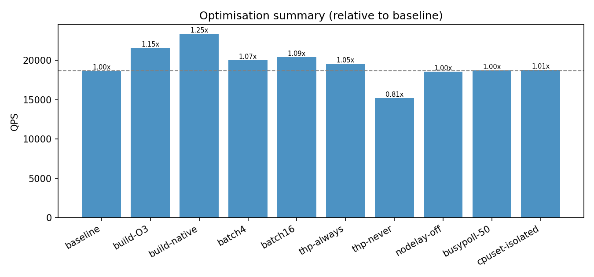

# 向量检索服务（HNSW）的全栈性能优化

> 「软件系统优化」课程项目① —— 在**真实应用负载**（SIFT1M 上的在线向量检索服务）上，
> 按「应用层 → 操作系统层 → 微体系结构层」自顶向下的方法定位瓶颈、实施优化并验证收益。

**核心结果：18,672 → 39,319 QPS（2.11×）**，`Recall@10` 恒为 **0.9516**，p99 **430 µs**（SLO ≤ 500 µs）。



| 配置 | QPS | 相对基线 | p50 | p99 | Recall@10 |
|---|---:|---:|---:|---:|---:|
| 基线（`-O2`、8 worker、THP=madvise） | 18,672 | 1.00× | 274 µs | 351 µs | 0.9516 |
| `-O3 -march=native`（AVX-512 距离核） | 23,373 | 1.25× | 219 µs | 287 µs | 0.9516 |
| native + 12 worker + THP=always | 34,506 | 1.85× | 240 µs | 406 µs | 0.9516 |
| **native + 16 worker + THP=always** | **39,319** | **2.11×** | 315 µs | 430 µs | **0.9516** |

分解：并发度 8→16 worker ×1.54、编译/SIMD ×1.37、THP ×1.05，乘积 ≈2.2×，与实测 2.11× 吻合
（说明没有隐藏的交互项）。

---

## 1. 业务场景与指标

向量检索是 RAG、推荐、以图搜图等业务的在线召回组件，业务方要求**在给定召回精度下**尽可能高的
吞吐和可控的尾延迟：

| 层次 | 指标 | 说明 |
|---|---|---|
| 业务 | `Recall@10 ≥ 0.95` 约束下的最大 QPS | 精度不达标，吞吐再高也没用 |
| 业务 | 单次查询成本（核·秒/查询） | 云上直接折算成钱 |
| 服务 | p50 / p90 / p95 / p99 / max | SLO 通常写在 p99 上 |
| 系统 | CPU 利用率、上下文切换、符号级热点 | 定位瓶颈用 |

数据集：**SIFT1M**（1,000,000 × 128 维 float32，平方 L2），10,000 条查询，官方 top-100 ground truth。
**不选**矩阵乘法（教学样例）与 Redis（课堂案例），避免与示例同构。

## 2. 四条主要结论

1. **瓶颈是距离计算 + 并行度，不是系统调用**。火焰图显示 74.7% 时间在
   `hnswlib::L2SqrSIMD16ExtAVX512`，图遍历 16.0%，系统调用路径仅 4.5%。
2. **编译器基线并不"慢"**：GCC 在 `-O2` 已用 SSE2 自动向量化，所以 AVX-512 的端到端收益是
   1.25×（不是理论 4×）——这是 Amdahl，也是"不能只看理论加速比"的实例。
3. **OS 层的真收益在内存页与拓扑**：关掉 THP 损失 18%；把 8 个 worker 压进 4 个物理核
   （超线程兄弟）吞吐 −12%、**p99 +38%**。
4. **三个"看起来该有用"的旋钮被数据否掉**：批处理（QPS 持平、单请求 p50 从 277 µs 涨到 3,888 µs）、
   `TCP_NODELAY`、`SO_BUSY_POLL`（virtio 不支持）均无收益。负结果同样写进报告。

## 3. 目录结构

```
.
├── README.md                 # 本文件
├── DATA_PROVENANCE.md        # 数据来源、SHA-256、派生规则、自检断言
├── PROJECT_LOG.md            # 全过程记录：时间线、决策、踩过的坑、待办
├── report.md                 # 研究报告（研究意义/方法/结果/对比/局限）
├── src/
│   ├── server.cpp            # 检索服务：TCP + hnswlib，SO_REUSEPORT 多 worker
│   ├── client.cpp            # 闭环压测客户端：QPS + 分位延迟 + recall@k
│   ├── probe.cpp             # 索引正确性探针（与暴力检索逐条比对）
│   └── l2kernel.c            # 独立 L2 距离核，供 llvm-mca 静态分析
├── scripts/
│   ├── fetch_parallel.py     # 24 路 range 并行下载数据集（单连接太慢）
│   ├── prepare_data.py       # SIFT hdf5 -> raw f32/i32
│   ├── make_synthetic.py     # 合成数据集（离线兜底）
│   ├── build.sh              # 三个编译档位（-O2 / -O3 / -O3 -march=native）
│   ├── bench.sh              # 单个实验点：起服务、压测 3 次、写 CSV
│   ├── run_all.sh            # 实验矩阵驱动
│   ├── sysinfo.sh            # 记录测量环境
│   ├── perf_profile.sh       # 软件事件 perf + 调用栈采样
│   ├── mca.sh                # llvm-mca 静态流水线分析
│   ├── plot.py               # 生成报告图表
│   └── summarize.py          # 中位数汇总表
└── results/
    ├── raw.csv               # 82 个测量点（原始数据）
    ├── summary.md            # 汇总表
    ├── env.txt               # 环境快照
    ├── figures/              # 4 张图（脚本生成，非手绘）
    ├── perf/                 # perf 统计、符号热点
    └── mca/                  # 三档汇编 + llvm-mca 报告
```

## 4. 复现

```bash
# 0) 依赖（Ubuntu 22.04 为例）
apt-get install -y build-essential linux-tools-$(uname -r) llvm clang aria2 python3-pip
pip3 install h5py numpy matplotlib pandas

# 1) hnswlib（header-only）
curl -sSL https://codeload.github.com/nmslib/hnswlib/tar.gz/refs/heads/master | tar xz
mv hnswlib-* hnswlib

# 2) 数据集（并行下载 + 校验，见 DATA_PROVENANCE.md）
python3 scripts/fetch_parallel.py --url http://ann-benchmarks.com/sift-128-euclidean.hdf5 \
        --out data/sift.hdf5 --sha256 dd6f0a6ed6b7ebb8934680f861a33ed01ff33991eaee4fd60914d854a0ca5984
python3 scripts/prepare_data.py --hdf5 data/sift.hdf5 --outdir data

# 3) 编译（服务端三档 + 客户端）
bash scripts/build.sh

# 4) 首次启动自动建索引（1M 点，8 线程，约 90 s），随后跑矩阵
bash scripts/run_all.sh all          # 约 15 min
python3 scripts/plot.py               # -> results/figures/*.png
python3 scripts/summarize.py          # -> 中位数汇总
bash scripts/sysinfo.sh               # -> results/env.txt
```

单独跑一个实验点：

```bash
bash scripts/bench.sh --label mytest --ef 64 --sthreads 8 --cthreads 8 --nq 1 \
     --nqtotal 200000 --reps 3 --thp always --server-cpus 0-11 --client-cpus 12-15
```

## 5. 实验矩阵

| 阶段 | 配置 | 层次 |
|---|---|---|
| baseline | `-O2`，8 worker，ef=64，THP=madvise | — |
| ef sweep | efSearch = 16/32/64/128/256 | 应用（精度-吞吐权衡） |
| threads | 1/2/4/8/12/16 worker | 应用（并发度） |
| batch | 每请求 1/4/16 条查询 | 应用（摊薄系统调用） |
| build flags | `-O2` → `-O3` → `-O3 -march=native` | 应用/编译（SIMD） |
| THP | always / madvise / never | OS（内存页） |
| TCP | `TCP_NODELAY` 开/关、`SO_BUSY_POLL` | OS（网络栈） |
| cpuset / 绑核 | 无隔离、4 物理核、8 物理核（SMT 感知） | OS（调度与缓存干扰） |

每个配置 **3 次重复取中位数并报范围**：同一配置在共享云主机上重复间波动 15%–30%，
**小于 5% 的差异在本平台不具备判别力**，报告中没有把这类差异当作结论。

## 6. 关于本仓库的取舍

| 内容 | 是否入库 | 原因 / 重建方式 |
|---|---|---|
| `data/sift.hdf5`、`base/query/gt` | ❌ | 合计约 1 GB，可下载 + 10 秒派生；校验和见 `DATA_PROVENANCE.md` |
| `data/index.bin`（630 MB） | ❌ | 并行插入导致字节不可复现（详见 `DATA_PROVENANCE.md` 3.1）；首启自动重建约 90 s |
| `build/`、`hnswlib/` | ❌ | `build.sh` / GitHub tarball |
| `results/perf/perf.data`、`perf-script.txt` | ❌ | 合计 27 MB 原始采样；`perf-report.txt` 已保留汇总证据 |
| 其余全部（代码/脚本/结果/报告/图） | ✅ | 40 个文件，约 0.8 MB |

## 7. 环境与已知限制

| 项 | 值 |
|---|---|
| 平台 | 阿里云 ECS，KVM，`cn-hangzhou` |
| CPU | Intel Xeon Platinum（Skylake 级），16 vCPU = **8 物理核 × 超线程**，单 NUMA，L3 33 MiB |
| 内存 / 磁盘 | 30 GiB / 200 GiB ESSD |
| OS / 工具链 | Ubuntu 22.04.5，kernel 5.15，g++ 11.4.0，perf 5.15.216 |
| **PMU** | **不可用**（`cycles/instructions` 均 `<not supported>`），故微体系层证据用火焰图 + `llvm-mca` 静态建模替代 |

限制：客户端与服务端同机（loopback），客户端竞争会压低服务端可达吞吐；无 PMU 因而没有
CPI/MPKI；只在单机上验证，未做多机压测。详见 `report.md` 第 6 节。

## 8. 参考

- Malkov & Yashunin, *Efficient and robust approximate nearest neighbor search using HNSW graphs*, TPAMI 2018
- Aumüller et al., *ANN-Benchmarks: A Benchmarking Tool for Approximate Nearest Neighbor Algorithms*, 2020
- B. Gregg, *Thinking Methodically about Performance*（USE 方法）, CACM 2013
- A. Yasin, *A Top-Down Method for Performance Analysis and Counters Architecture*, ISPASS 2014
