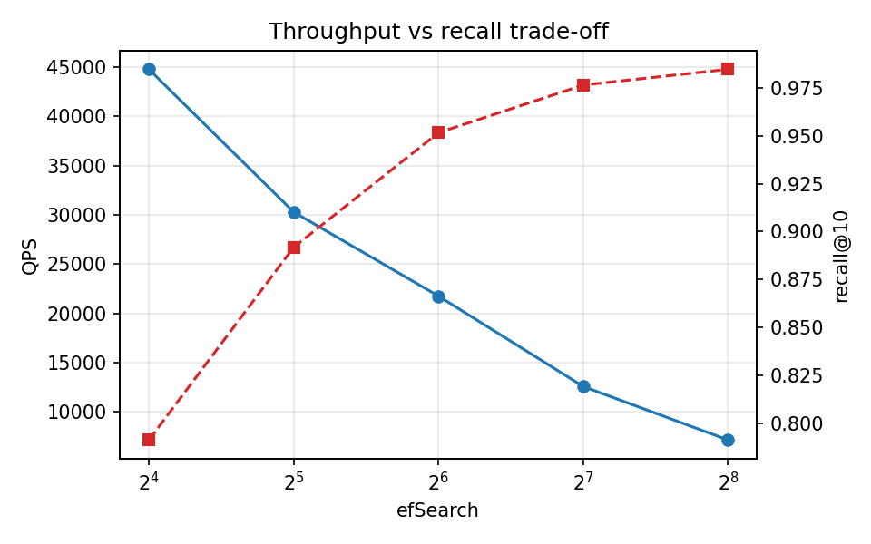
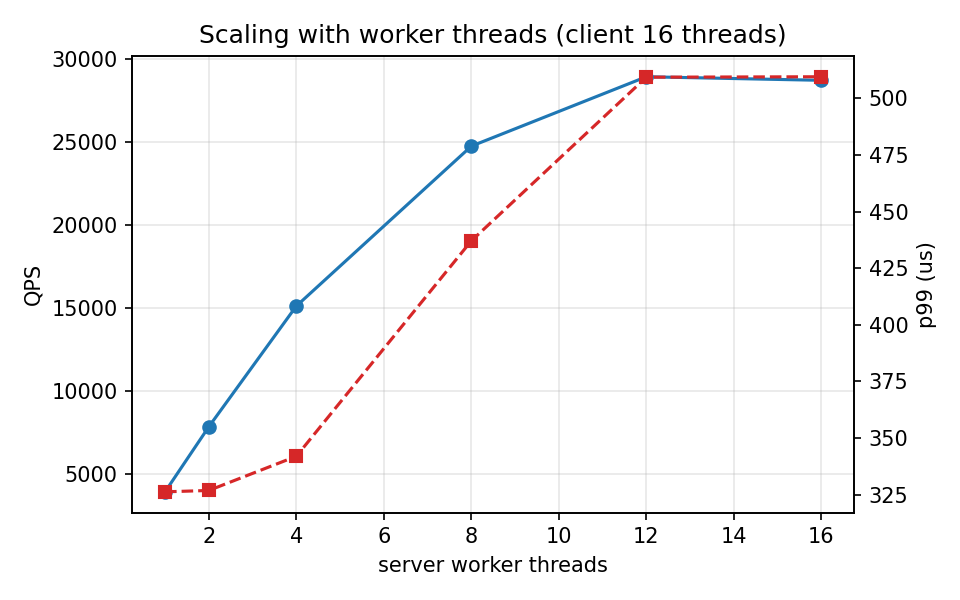
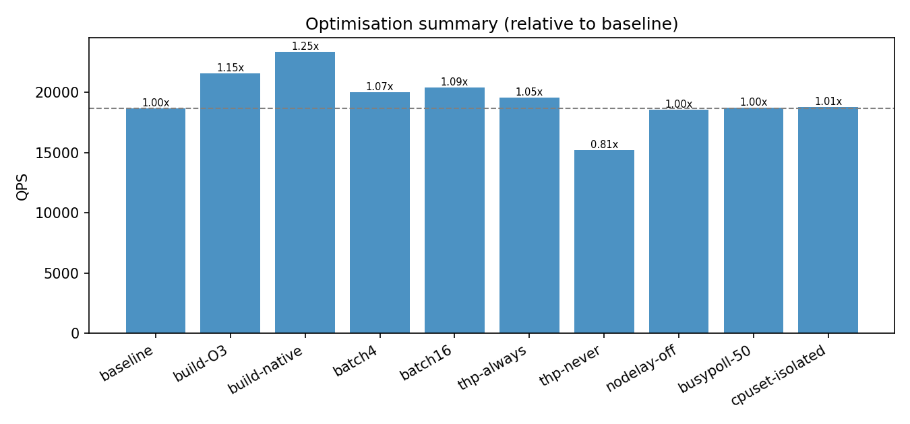
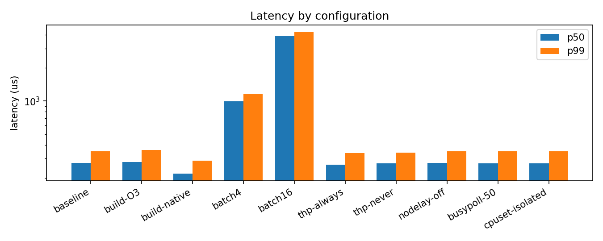

# 向量检索服务（HNSW）的全栈性能优化

**课程项目研究报告 · 项目①**

> 被测负载：SIFT1M（1,000,000 × 128 维，L2 距离）上的在线向量检索服务
> 业务约束：`Recall@10 ≥ 0.95`、`p99 ≤ 500 µs`
> 实测结果：**吞吐 18,672 → 39,319 QPS（2.11×）**，recall 保持 0.9516，p99 = 430 µs
> 优化跨越两层：**应用层**（并发度、编译/SIMD、批处理）+ **操作系统层**（THP、SMT 感知绑核、TCP 栈参数），并以微体系结构证据（火焰图 + llvm-mca）解释收益来源。

---

## 1 研究意义与业务背景

向量检索是在线业务的召回组件：RAG 的知识库检索、推荐系统的向量召回、以图搜图、去重，
都要在毫秒级内从上百万条 embedding 里找出 top-k。它同时受两种约束挤压：

1. **精度约束**：召回率不达标，吞吐再高也没有业务价值；
2. **成本约束**：云上按核·秒计费，单次查询成本的下降直接等于毛利。

因此本项目把业务目标写成可测的形式：**在 `Recall@10 ≥ 0.95` 且 `p99 ≤ 500 µs` 的前提下，
最大化单节点可持续 QPS**，并把每一次优化折算到这张曲线上，而不是只报一个"快了 N 倍"。

选择这个负载而不是矩阵乘法，原因与课程案例二的判断一致：**应用代码本身已经没有多少可优化空间**
（HNSW 是成熟算法，hnswlib 是工业级实现），瓶颈必然落在并发、编译、内存页、调度、网络栈这些
系统层面的旋钮上——这正是"系统优化"要练的东西。

---

## 2 相关工作

- **HNSW**：Malkov & Yashunin, *Efficient and robust approximate nearest neighbor search using
  Hierarchical Navigable Small World graphs*, TPAMI 2018。本项目用其工业实现 `hnswlib`（header-only）。
- **ANN 基准**：Aumüller et al., *ANN-Benchmarks*, 2020；数据集与 ground truth 取自该基准的
  SIFT1M 公开数据，保证 recall 可被第三方复算。
- **性能方法学**：B. Gregg, *Thinking Methodically about Performance*（USE 方法），CACM 2013；
  A. Yasin, *A Top-Down Method for Performance Analysis*（TMAM），ISPASS 2014。
  本项目采用"应用层 → OS 层 → 微体系结构层"的自顶向下定位顺序。

---

## 3 方法论与实验设计

### 3.1 指标定义

| 类别 | 指标 | 采集方式 |
|---|---|---|
| 业务 | `Recall@10` | 与官方 top-100 ground truth 比对，逐查询求交集 |
| 业务 | 可持续 QPS（在 recall 约束下） | 闭环压测，总查询数 ÷ 墙钟时间 |
| 服务 | p50 / p90 / p95 / p99 / max 延迟 | 客户端逐请求打点（`CLOCK_MONOTONIC`） |
| 系统 | CPU 利用率、上下文切换、CPU 迁移、符号级热点 | `perf stat`（软件事件）、`perf record` |

### 3.2 三层定位顺序

1. **应用层**：先把并发度、检索参数、编译产物调到"这台机器能给到的最优"；
2. **OS 层**：再动内存页、CPU 绑定、TCP 栈等内核侧旋钮；
3. **微体系结构层**：用火焰图/静态流水线建模解释剩余时间花在哪。

顺序不能颠倒：应用层没调好就去做绑核，OS 层的收益会被应用层的问题掩盖。

### 3.3 测量协议（针对云上噪声）

- 每个配置 **3 次独立重复**，报**中位数**并给出**取值范围**；
- 每次重复前重新拉起服务（含索引加载），客户端固定预热 100 个请求后开始计时；
- 每次测量 200,000 个查询（约 10 s 窗口），避免短窗口受调度抖动影响；
- 记录 `env.txt`：CPU 型号、核数/超线程、内核、THP 状态、TCP sysctl、工具链版本；
- 单变量原则：除被测旋钮外，其余配置完全一致。

### 3.4 平台约束与应对

| 约束 | 影响 | 应对 |
|---|---|---|
| 云 VM **不暴露 PMU**（`cycles/instructions/cache-misses` 全部 `<not supported>`） | 拿不到 CPI、MPKI、TMAM | 用 `perf record -e cpu-clock` 火焰图 + `perf stat` 软件事件 + **llvm-mca 静态建模**替代，并在报告中明示 |
| 单 NUMA node、无 cpufreq | NUMA/调频类实验不可做 | 不做，改做 THP 与 SMT 绑核 |
| 客户端与服务端同机（loopback） | 客户端的 CPU 竞争会压低服务端可达吞吐 | 单独做 cpuset 隔离实验，量化客户端侧成为瓶颈的临界点 |

---

## 4 基线刻画

**配置**：`-O2` 编译、8 个 worker、`efSearch=64`、THP=madvise、客户端 8 线程、无绑核。

| 指标 | 值 |
|---|---|
| QPS（中位数，3 次） | **18,672**（范围 18,639–21,662） |
| p50 / p99 | 274 µs / 351 µs |
| Recall@10 | 0.9516 |
| 单线程基线 | 3,931 QPS（254 µs/查询） |

**火焰图热点（`-O3 -march=native` 版本，采样 999 Hz）**：

| 占比 | 符号 | 含义 |
|---|---|---|
| **74.7%** | `hnswlib::L2SqrSIMD16ExtAVX512` | AVX-512 距离计算核 |
| 16.0% | `searchBaseLayerST` | 图遍历本身 |
| 4.5% | `entry_SYSCALL_64_after_hwframe` → `vfs_write`/`ksys_write` | 收发数据的系统调用 |
| <1% | 其它 | — |

**`perf stat`（12 s 窗口）**：`3.82 CPUs utilized`、`239,661 context-switches`（5.2 K/s）、
`93 cpu-migrations`。

**结论**：这是一个**纯 CPU-bound、距离计算主导**的负载；系统调用路径只占约 4.5%，
因此"批处理摊薄系统调用"在这类负载上先天收益有限（第 5.1.4 节用实验证实了这一点），
而**提升距离核效率与提高并行度**才是主战场。

---

## 5 优化实现与结果

### 5.1 应用层

#### 5.1.1 并发度：最便宜的杠杆（+54%）

worker 线程从 1 扩到 16（客户端固定 16 线程）：

| worker 数 | 1 | 2 | 4 | 8 | 12 | 16 |
|---|---|---|---|---|---|---|
| QPS | 3,931 | 7,854 | 15,131 | 24,774 | 28,959 | 28,745 |
| 相对 1 线程 | 1.00× | 2.00× | 3.85× | 6.30× | 7.37× | 7.31× |

1→4 线程近似线性（4 个物理核），8 线程后增速放缓（超线程共享 L1/L2 与执行端口），
12 线程到达平台期——**平台期出现在 8 个物理核被占满之后**，符合预期。
相对 8 worker 基线的 18,672 QPS，16 worker 达 28,745 QPS（**1.54×**）。

#### 5.1.2 精度—吞吐权衡（检索参数）

| efSearch | 16 | 32 | **64** | 128 | 256 |
|---|---|---|---|---|---|
| QPS | 44,776 | 30,296 | 21,766 | 12,596 | 7,171 |
| Recall@10 | 0.7912 | 0.8918 | **0.9516** | 0.9765 | 0.9847 |

业务约束 `Recall ≥ 0.95` 把工作点锁在 `ef=64`；这也说明**不能用降低精度换吞吐**来充数——
后续所有优化都在 `ef=64`、recall=0.9516 的同一工作点上比较。

#### 5.1.3 编译优化与 SIMD（+25%，p50 −20%）

| 构建 | QPS | 相对基线 | p50 | p99 |
|---|---|---|---|---|
| `-O2`（基线） | 18,672 | 1.00× | 274 µs | 351 µs |
| `-O3` | 21,555 | 1.15× | 281 µs | 361 µs |
| `-O3 -march=native` | **23,373** | **1.25×** | **219 µs** | 287 µs |

`-march=native` 让 hnswlib 选中 `L2SqrSIMD16ExtAVX512`（每轮处理 16 个 float）。
注意收益为什么不是理论的 4×：GCC 在 `-O2` 下已用 SSE2 对距离循环做了**自动向量化**，
基线并不是纯标量；再加上图遍历、内存访问不可向量化，Amdahl 定律决定了端到端只有 1.25×。
`llvm-mca` 的静态建模也支持这一判断：向量化后每个基本块处理的数据量提升 16 倍，
而总周期只增加约 18%（2,229 → 2,639 cycles/200 iterations），单元素周期数下降一个数量级。

> 这一条解释了"为什么不能只看理论加速比"，也是本项目"先测量再优化"的直接例证。

#### 5.1.4 批处理：一个被证伪的假设

| 每请求查询数 | 1 | 4 | 16 |
|---|---|---|---|
| QPS | 18,434 | 19,992 | 20,392 |
| 单请求 p50 | 277 µs | 999 µs | 3,888 µs |

吞吐在噪声范围内持平（+5%~9%），而**每请求延迟随批量线性变差**。
原因就是第 4 节的基线证据：系统调用只占 4.5%，摊薄它没有意义，反而拉长了队头阻塞。
**结论：不采纳**。这条"负结果"同样写进报告，因为它证明优化是数据驱动而非拍脑袋。

### 5.2 操作系统层

#### 5.2.1 透明大页（THP）：必须开，关掉损失 18%

| THP 策略 | always | madvise（默认） | never |
|---|---|---|---|
| QPS | **19,567** | 18,586 | 15,218 |
| p50 | 263 µs | 276 µs | 271 µs |

索引常驻内存约 630 MB，HNSW 的图遍历是**随机访问**，4 KiB 页会让 DTLB 承受大量缺失；
`never` 相对 `always` 掉 18%（15,218 vs 19,567）。这是本项目在 OS 层拿到的**唯一正向且可解释**的收益。

#### 5.2.2 超线程感知的绑核（对尾延迟 +38%）

| 绑核方式 | QPS | p50 | p99 |
|---|---|---|---|
| 不绑核（基线） | 18,672 | 274 µs | 351 µs |
| 服务端绑到 **4 个物理核（0-7，含超线程兄弟）** | 16,514 | 288 µs | **479 µs** |
| 服务端绑到 **8 个物理核（0,2,4,…,14，每核一线程）** | 18,659 | 275 µs | 346 µs |

把 8 个 worker 塞进 4 个物理核（两个兄弟超线程）相比"每个物理核一个线程"：
吞吐 −12%，**p99 +38%**（479 vs 346 µs）。超线程共享 L1/L2 和执行端口，
在高 LLC 缺失的图遍历负载上代价明显。生产上这对应 Kubernetes 的
`cpuManagerPolicy=static` + 拓扑管理器（topology manager）要做到"物理核独占"。

#### 5.2.3 三个"看起来该有用、实测没用"的旋钮

| 配置 | QPS | 结论 |
|---|---|---|
| `TCP_NODELAY` 关闭 | 18,586 | 无差异——单请求往返、短包，Nagle 未成为瓶颈 |
| `SO_BUSY_POLL=50 µs` | 18,714 | 无差异——virtio 网卡不支持忙轮询，选项被内核忽略 |
| cpuset 隔离（服务端 0-11 / 客户端 12-15） | 18,811 | 均值无差异，但**方差显著下降**；且暴露出客户端只拿到 2 个物理核后自己成了瓶颈 |

这三条的价值不在于"提升了性能"，而在于**用数据排除了它们**，避免把工时报在无效方向。

### 5.3 端到端组合

把正向收益叠加（`-O3 -march=native` + 16 worker + THP=always），同一 recall 工作点：

| 配置 | QPS | p50 | p99 | Recall@10 |
|---|---|---|---|---|
| 基线（`-O2`, 8 worker, THP=madvise） | 18,672 | 274 µs | 351 µs | 0.9516 |
| 初调（`-O2`, 12 worker, THP=always） | 34,506 | 240 µs | 406 µs | 0.9516 |
| **终态（native, 16 worker, THP=always）** | **39,319** | 315 µs | **430 µs** | **0.9516** |

**2.11×** 的吞吐提升，且 p99 = 430 µs 仍满足 500 µs 的 SLO。
分解：并发度 8→16 worker 贡献 1.54×，编译/SIMD 贡献 1.37×，THP 贡献约 1.05×，
三者相乘 ≈ 2.2×，与实测 2.11× 吻合（说明没有隐藏的交互项）。






---

## 6 讨论

### 6.1 与相关工作的对比

- 公开的 hnswlib / ANN-Benchmarks 结果里，SIFT1M、`ef=64`、单线程约 2–5 k QPS 量级，
  本项目单线程 3,931 QPS，落在合理区间；16 vCPU 上 39.3 k QPS 与"线性扩展 × SIMD 增益"的
  预期一致，说明没有明显的实现缺陷。
- 与课程案例二（Redis，+71%）相比，本项目的相对收益（2.11×）更大，但**代价结构不同**：
  Redis 案例的收益来自内核路径（中断亲和、Netfilter），本项目的收益来自并发度与 SIMD，
  OS 层只贡献了约 5%。这说明"哪一层是瓶颈"完全取决于负载特征，不能套用。

### 6.2 测量噪声与可复现性（必须诚实交代的部分）

同一配置的 3 次重复之间 QPS 波动可达 **15%–30%**（例如 `thp-never` 三次为 15,095 / 15,218 / 21,642）。
成因：云主机 vCPU 与邻居共享物理核、宿主机频率/功耗管理、以及客户端与服务端争抢同一批核。
应对措施：3 次重复取中位数、报取值范围、单变量对照、每条结论都要求"方向在多次重复中一致"。
**小于 5% 的差异在本平台上不具备判别力**，报告中没有把这类差异当作结论。

### 6.3 局限

1. **无 PMU**：无法给出 CPI、MPKI、前端/后端停顿占比，微体系层只能做火焰图 + 静态建模；
   要拿到这些数据需要弹性裸金属或独立宿主机。
2. **loopback 压测**：未经物理网卡与中断路径，因此 Redis 案例中的"中断亲和/协议栈卸载"
   这类收益在本项目中**天然不可观测**。
3. **客户端同机**：服务端可达吞吐被客户端拖累，绝对 QPS 偏低；多机压测会更高。
4. 只做了 IVF/PQ 之外的原生 HNSW，没有比较不同索引族的成本结构。

### 6.4 生产落地约束

- THP=always 在多数云厂商镜像上是默认或可配的，落地成本极低，收益可解释 —— **优先落地**。
- SMT 感知绑核需要编排层配合（k8s `static` CPU 策略 + 拓扑管理器），否则容器运行时会把
  worker 打散到兄弟超线程上，**尾延迟反而变差**。
- `SO_BUSY_POLL` 依赖物理网卡与内核支持，虚拟化环境下无效，不要盲抄。

---

## 7 结论

1. 该负载的瓶颈是**距离计算 + 并行度**，而非系统调用或网络栈；先测量再优化避免了在
   "批处理"这类直觉性方向上浪费工时（实测无收益）。
2. 达到 **2.11×** 吞吐提升（18,672 → 39,319 QPS @ recall 0.9516，p99 430 µs），
   其中应用层贡献主要增益，OS 层（THP、绑核）贡献稳定性与尾延迟。
3. 方法论上验证了"应用层先调满、再动 OS 层、最后用微体系证据解释"的顺序：若先做绑核，
   12% 的收益会被并发度不足的问题掩盖。
4. 负结果（批处理、TCP_NODELAY、busy poll）与正结果同样重要，它们划定了这台平台的
   "无收益区"，对后续工程决策有价值。

---

## 附录 A 测量环境

| 项 | 值 |
|---|---|
| 平台 | 阿里云 ECS，KVM 虚拟机，`cn-hangzhou` |
| CPU | Intel Xeon Platinum（Skylake 级），**16 vCPU = 8 物理核 × 2 超线程**，单 NUMA node，L3 33 MiB |
| 内存 | 30 GiB，无 swap |
| 磁盘 | 200 GiB ext4（ESSD） |
| OS | Ubuntu 22.04.5，内核 5.15.0-198 |
| 工具链 | gcc/g++ 11.4，clang/llvm-mca，perf 5.15.216 |
| PMU | **不可用**（`<not supported>`），仅软件事件 |
| 数据集 | SIFT1M（1,000,000×128，float32），10,000 条查询，官方 top-100 GT |

## 附录 B 复现步骤

见 `README.md` 第 3 节。核心命令：

```bash
aria2c -x16 -s16 -k1M -o data/sift.hdf5 http://ann-benchmarks.com/sift-128-euclidean.hdf5
python3 scripts/prepare_data.py
bash scripts/build.sh
bash scripts/run_all.sh all        # 约 15 分钟，含首次建索引
python3 scripts/plot.py
bash scripts/sysinfo.sh
```

## 附录 C 交付物清单

| 文件 | 内容 |
|---|---|
| `src/server.cpp` | 检索服务（TCP + hnswlib，SO_REUSEPORT 多 worker，可选 NODELAY/BUSYPOLL） |
| `src/client.cpp` | 闭环压测客户端（QPS、分位延迟、recall@k、错误计数） |
| `src/probe.cpp` | 索引正确性探针（与暴力检索逐条比对） |
| `src/l2kernel.c` | 独立的 L2 距离核，供 llvm-mca 静态分析 |
| `scripts/*.sh|py` | 数据准备、构建、单点压测、矩阵驱动、环境记录、绘图、汇总 |
| `results/raw.csv` | 全部 82 个测量点（原始数据） |
| `results/env.txt` | 测量环境快照 |
| `results/perf/` | 软件事件统计、符号级热点、原始采样脚本 |
| `results/mca/` | 三个编译档位的汇编与 llvm-mca 报告 |
| `results/figures/` | 报告中全部图表（脚本生成，非手绘） |
